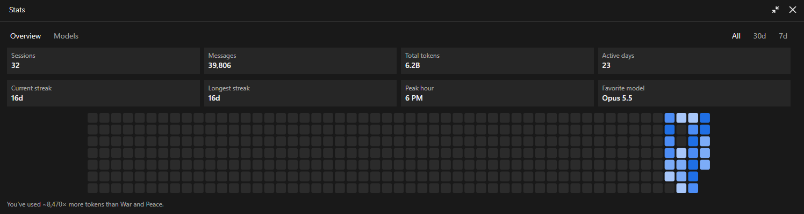
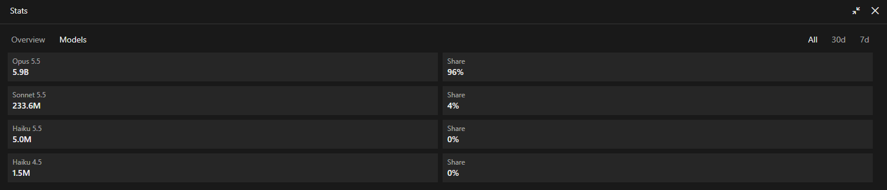

# claude-heatmap

Bring back the old Claude Code stats view: your sessions, messages, tokens, streaks and a calendar-style activity heatmap, in a pane beside the chat.





## Features

- **Stat cards**: sessions, messages, total tokens, active days, current and longest streak, peak hour and favorite model.
- **Ranges**: switch the totals between **All**, **30d** and **7d**.
- **Models tab**: tokens per model and each model's share.
- **Activity heatmap**: one square per day, shaded by how much you used Claude that day. Hover a square to see that day's messages and tokens.
- **Opens by itself** when a session starts, or only when you ask: your choice with `/heatmap auto on|off`.
- Works in the **desktop app** (rounded squares with tooltips) and the **terminal** (a text grid).

## Install

In a Claude Code terminal session:

```
/plugin install stats-heatmap --marketplace gtorresc/claude-heatmap
```

Answer `y` to **Add marketplace?**, then pick a scope (**user** makes it load in every session). Once the marketplace is added, `/plugin install stats-heatmap@gtorresc` works too.

From a shell:

```bash
claude plugin install stats-heatmap --marketplace gtorresc/claude-heatmap
```

In the desktop app, where `/plugin` doesn't run: click **+** next to the prompt box, then **Plugins**, **Add marketplace** with `gtorresc/claude-heatmap`, then **Add plugin**. A plugin installed from a terminal at the user scope also loads in the desktop app.

## Usage

| Command | What it does |
| --- | --- |
| `/heatmap` | Opens the Stats pane |
| `/heatmap auto off` | Stops the pane from opening when a session starts |
| `/heatmap auto on` | Opens it at session start again (the default) |
| `/heatmap auto` | Says whether auto-open is on or off |

## How it works

Claude Code keeps a summary of your usage in `~/.claude/stats-cache.json` (or under `CLAUDE_CONFIG_DIR` if you set it): daily message and session counts, tokens per model per day, and session start hours. This mod reads that file and draws it. It sends nothing anywhere, has no dependencies and needs no setup.

The numbers are as fresh as Claude Code last wrote that file, so today can lag a little. Token counts include cache reads, the same figure the original view used.

## How it was made

This mod was built entirely by **Claude**, inside Claude Code, using Claude Code's own mod system (hooks modules that draw panes beside the chat). Starting from a screenshot of the old stats view that a Claude Code update removed, I asked Claude to bring it back; it found the stats file the old view read, built the pane, wrote the tests and iterated on the design from my feedback. The commits are mine; the code is Claude's.

## Development

```bash
git clone https://github.com/gtorresc/claude-heatmap.git
cd claude-heatmap
claude plugin validate .   # checks the manifest and the hooks module
claude plugin test .       # runs tests/pane.test.tsx
claude --plugin-dir .      # starts a session with your local copy loaded
```

The whole mod is [`hooks/register.tsx`](hooks/register.tsx). Claude Code writes the API's TypeScript types to `.claude-plugin/types/` when it loads the mod.

## Contributing

Issues and pull requests are welcome. See [CONTRIBUTING.md](CONTRIBUTING.md).

## License

[MIT](LICENSE) © 2026 gtorresc
